<p align="center">
  
</p>

<p align="center">
  <a href="https://juch-guliquey.vercel.app"></a>
  <a href="https://www.linkedin.com/in/juch-guliquey-b78277376/"></a>
  <a href="mailto:guliqueyjuch@gmail.com"></a>
</p>

I build AI features that real users depend on, and the full-stack product around them. I ship LLM features into production, measure them, and keep them fast, cheap and safe.


### `~/focus`

- 🧠 **Multimodal AI:** product identification from photos with Gemini on Vertex AI through Genkit, constrained to fixed vocabularies and checked before it reaches users
- 📏 **LLM evaluation:** test-set harnesses that measure accuracy, latency and cost, then drive model and prompt tuning
- 📚 **RAG and grounded assistants:** retrieval over a custom knowledge base, in-app help chats with rate limiting and prompt-injection hardening
- 🔌 **Production integrations:** payments, marketplaces, shipping and messaging, built on signed webhooks and idempotent processing

### `~/projects`

| Project | What it is |
| :-- | :-- |
| 🌐 [**Portfolio**](https://juch-guliquey.vercel.app) · [code](https://github.com/JohnSmith545/portfolio) | Case studies of the client platforms I've built, with screenshots of the AI features |
| 🛰️ [**ORION AI**](https://github.com/JohnSmith545/ORION-AI) | RAG chatbot with cited answers: Vertex AI embeddings and Vector Search, Gemini generation, Firebase and tRPC |
| 🥗 [**Fuel and Flow**](https://github.com/JohnSmith545/Fuel-and-Flow) | Nutrition and energy tracker that links meals to how you feel, with allergen safety checks and rule-based dietary suggestions |


### `~/about.ts`

```ts
const juch = {
  role: "AI Engineer | Full-Stack Developer",
  basedIn: "Cavite, Philippines 🇵🇭",
  ships: ["LLM features", "eval harnesses", "RAG", "integrations"],
  favouriteModel: "whichever one passes the eval",
  debugging: "write the failing test first, then argue with it",
  promptStyle: "short, specific, and versioned in git",
  currentlyLearning: ["agentic workflows", "better evals"],
} as const;
```

### `~/stack`

<p>
  
  
  
  
  
  
  
  
  
  
  
  
  
  
</p>

### `~/certs`

- 🎓 **Attention Mechanism** and **Encoder-Decoder Architecture**, Google Cloud (2026)
- 🎓 **RAG Application Specialist**, Hytel AI Enablement Program (2026)
- 🗣️ **English C2 Proficient**, EF SET (2025)
- 📜 BS Computer Science, Cum Laude


<p align="center"><code>$ exit 0</code> &nbsp;·&nbsp; thanks for stopping by</p>
